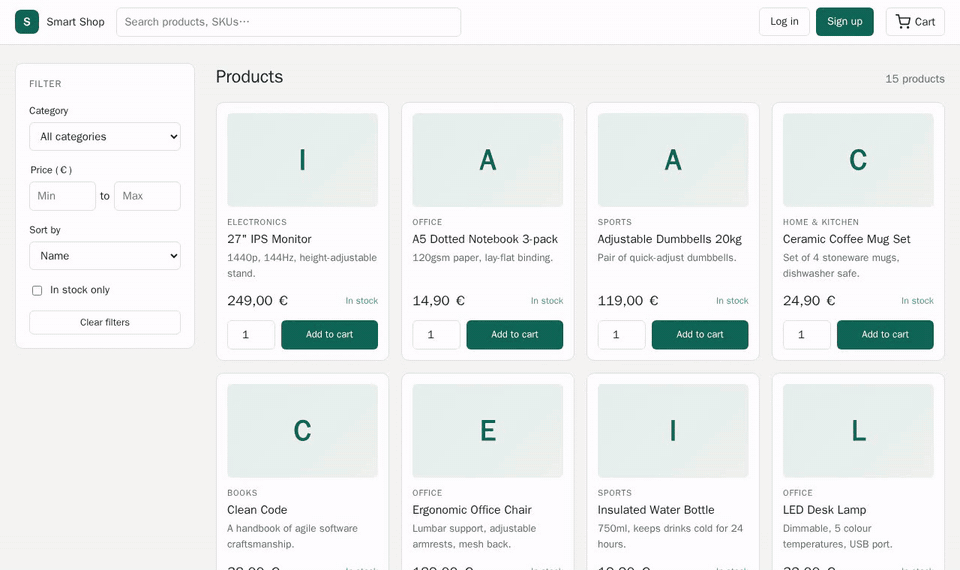

# Smart Shop

[](https://github.com/User-Paolo/smart-shop/actions/workflows/ci.yml)


[](LICENSE)

Originally built over two semesters in 2024 and 2025 for university coursework.

An online shop with a stock back office that predicts demand. Customers browse, search and buy, and administrators manage products and orders. A separate Python service looks at the last 90 days of sales, forecasts the next 7, and the dashboard flags every product that is likely to run out so the admin can restock in time.



| Layer | Technology | Role |
|---|---|---|
| Frontend | TypeScript, HTML, CSS (no framework) | Storefront and admin dashboard, Fetch API, Canvas charts |
| Backend | PHP 8 (OOP, MVC, no framework) | Stateless REST API, JWT login, business rules |
| Database | MySQL 8 | 3NF schema, foreign keys, ACID transactions |
| Analytics | Python, pandas, scikit-learn | 7 day demand forecast, runs apart from the web server |

## Features
**Customer portal**
* **Accounts:** Sign up and log in, with Argon2id password hashing and a limit on failed logins.
* **Catalogue:** Live search, category and price filters, an in stock filter, sorting and paging, all without page reloads.
* **Cart:** Stored in the database, so it survives logouts and other devices. Add, change quantities and remove.
* **Checkout:** One ACID transaction that takes the stock and creates the order, with row locks so two customers can never buy the same last unit.
* **Order history:** Every past order with its status.

**Admin dashboard**
* **Predictive analytics:** KPI cards, a demand against stock chart for every product, a 30 day sales chart with the 7 day forecast for any product, and a risk table that flags **High risk of stockout** items with a one click restock.
* **Run forecast:** Starts the Python job in the background, and the page follows its progress.
* **Inventory:** Add products, edit prices and details, adjust stock up or down, deactivate or reactivate.
* **Orders:** Filter by status, page through them, ship, deliver or cancel. Cancelling returns the stock.

## How the Forecast Works
For every active product, `analytics/forecast.py`:
1. Reads the units sold per day over the last 90 days, leaving out cancelled orders, and fills days without sales with 0.
2. Fits a linear regression with a trend and a flag for each weekday, so it picks up both growth and busier weekends.
3. Tests that model on the last 14 days against a simple 28 day average, and keeps whichever predicted better.
4. Predicts the next 7 days and writes them to `inventory_forecasts` in one transaction.

On the demo data the regression wins for 11 of the 15 products, and the final forecasts are 8.7% more accurate than the average alone. PHP then marks a product **High risk** when its predicted 7 day demand reaches its stock, **Watch** at 70%, and suggests restocking two weeks of demand.

## Design Decisions
* **No frameworks on purpose:** The router, MVC layers, JWT handling and DOM helpers are all written by hand, so every mechanism can be explained line by line.
* **Rules live in the API:** The frontend checks every form for quick feedback, but the PHP API checks everything again and never trusts the browser.
* **Stateless logins with fresh roles:** Logins use signed tokens with no server session, and every request still loads the user's current role, so a demoted admin or deleted account loses access at once.
* **Heavy work stays out of web requests:** PHP only starts the Python job and answers 202 straight away. The two share data through the database and a small status file.
* **Security in the basics:** Every query uses prepared statements, page content is always added as text and never as HTML, and the app's database account can only read and write rows.

The full design is in the [architecture report](docs/ARCHITECTURE.md).

## REST API
Protected routes need `Authorization: Bearer <token>`, and every write also needs `X-CSRF-Token`. Both come back from login and sign up.

| Method | Endpoint | Access | Purpose |
|---|---|---|---|
| POST | `/api/auth/register`, `/api/auth/login` | public | Create an account, log in |
| GET | `/api/auth/me` | user | Current user |
| PATCH | `/api/users/me` | user | Change own name or password |
| GET | `/api/products`, `/api/products/{id}`, `/api/categories` | public | Catalogue with search, filters, sorting and paging |
| GET, POST | `/api/cart`, `/api/cart/items` | user | View the cart, add a product |
| PATCH, DELETE | `/api/cart/items/{productId}` | user | Change a quantity, remove a line |
| POST, GET | `/api/orders`, `/api/orders/{id}` | user | Checkout, own orders |
| GET, POST, PATCH, DELETE | `/api/admin/products`, `/api/admin/products/{id}` | admin | Inventory |
| POST | `/api/admin/products/{id}/stock` | admin | Adjust stock |
| GET, PATCH | `/api/admin/orders`, `/api/admin/orders/{id}/status` | admin | All orders, change status |
| GET, PATCH, DELETE | `/api/admin/users`, `/api/admin/users/{id}`, `/api/admin/users/{id}/role` | admin | Users and roles |
| GET, POST | `/api/admin/forecasts`, `/api/admin/forecasts/run`, `/api/admin/forecasts/status` | admin | Forecast summary, start the job (202), progress |
| GET, POST | `/api/admin/forecasts/{productId}/history`, `/api/admin/forecasts/{productId}/restock` | admin | Sales history, authorize a restock |

Status codes used: 200, 201, 202, 204, 400, 401, 403, 404, 405, 409, 415, 422, 429 and 500.

## Project Structure
```
backend/
  public/index.php        Single entry point for the API
  src/Core/               Router, Request, Response, Auth with JWT, Database, Validator
  src/Controllers/        User, Product, Cart, Order, Forecast
  src/Models/             User, Product, Cart, Order, Forecast
  src/routes.php          The route table
  config/config.php       Settings, each one can be overridden by an environment variable
  bin/seed.php            Demo data: 15 products, 9 users, 90 days of orders
frontend/
  index.html, admin.html  Storefront and dashboard
  ts/                     TypeScript source (strict mode)
  css/styles.css          Grid and Flexbox layout with light and dark themes
analytics/                Forecaster and its tests
database/                 Schema and database user scripts
tests/                    API tests and browser tests in JavaScript, unit tests for the validation
docs/                     Architecture report and demo GIF
server.php                Development server router: /api goes to PHP, everything else to frontend/
```

## Running
**With Docker (easiest).** One command starts MySQL, builds the TypeScript, loads the demo data, runs the first forecast and serves the app:

```
docker compose up --build
```

Then open http://localhost:8000. If port 8000 is busy, start it with `APP_PORT=8080` in front of the command.

| Account | Email | Password |
|---|---|---|
| Admin | `admin@smartshop.test` | `Admin1234` |
| Customer | `customer1@smartshop.test` up to `customer8@smartshop.test` | `Customer123` |

**Without Docker (for example with XAMPP on Windows).** You need PHP 8, MySQL or MariaDB, Python 3 and Node.js. From the project folder:

```
mysql -u root < database/create_user.sql
mysql -u root smart_shop < database/schema.sql
php backend/bin/seed.php
pip install -r analytics/requirements.txt
python analytics/forecast.py
npm install
npm run build
php -S localhost:8000 server.php
```

With XAMPP the commands are `C:\xampp\mysql\bin\mysql.exe` and `C:\xampp\php\php.exe`. Every setting in `backend/config/config.php` can be changed through environment variables (`DB_HOST`, `DB_USER`, `JWT_SECRET`, `APP_TIMEZONE` and so on). The forecast can also run on a schedule, for example with CRON or the Windows Task Scheduler.

## Running Tests
```
npm ci
npm run test:unit
docker compose up -d --build
npm run test:api
npx playwright install --with-deps chromium
npm run test:e2e
cd analytics && python -m pytest
```

There are 43 tests in total:
* **21 API tests** in JavaScript cover status codes, validation, permissions, CSRF, the login limit, demoted and deleted accounts, checkout, six customers racing for the last two units and the forecast job.
* **12 browser tests** with Playwright run 6 complete flows on a desktop and a phone sized screen, from sign up to checkout and through every dashboard tab, and fail on any browser error.
* **5 unit tests** check the TypeScript form validation, and **5 forecaster tests** check that the model learns trends and weekdays and switches to the average when the regression loses.

Every push runs all of them on GitHub Actions against the full Docker setup.

## Known Simplifications
* PHP's built in server is used, which is fine for a demo. A real deployment would sit behind Apache or Nginx.
* Payment is simulated, so checkout only creates the order and takes the stock.
* Login tokens cannot be cancelled before they expire, although the role and account check covers the main risk.
* The forecast is a single number per day, with no confidence range.
* Product pictures are placeholders with the product's first letter.

## License
This project is licensed under the MIT License. See [LICENSE](LICENSE).
