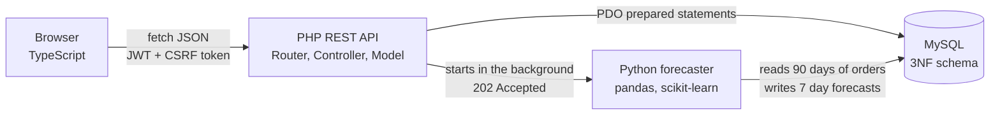
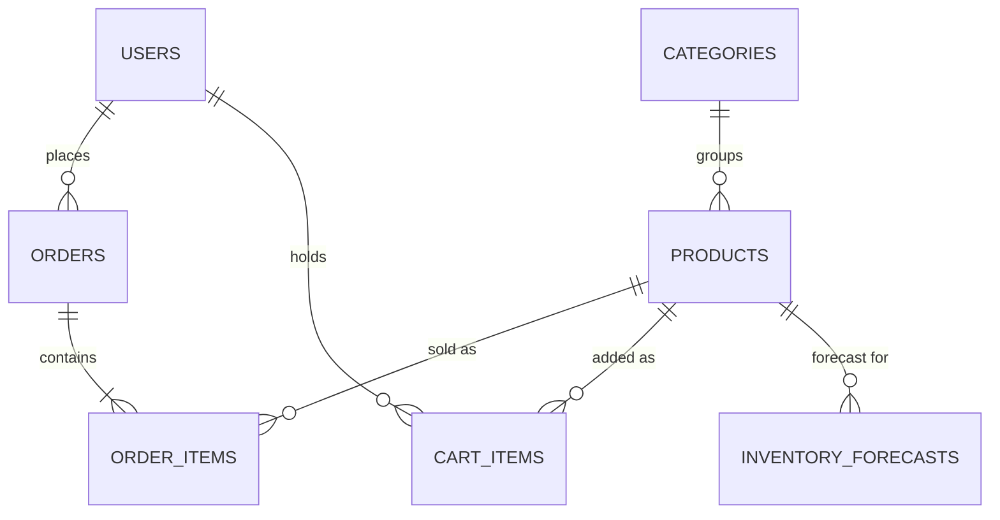

# Architectural Report: Smart Shop

*Advanced Web Information Systems, 3rd year. Design and implementation of a data driven ecommerce architecture, built over two semesters in 2024 and 2025.*

## 1. Objective and Overview

Smart Shop is an online store with an inventory back office attached to it. Customers browse, search and buy, and administrators manage products and orders. The part that makes it more than a shop is predictive restocking. A separate analytics service looks at the last 90 days of sales, forecasts each product's demand for the next 7 days, and the dashboard flags the products that are likely to run out before the next delivery. The administrator can then authorize a restock in advance.

The assignment asks for a strict separation of concerns, so the system is split into four tiers. Each tier talks to the others only through a fixed contract, JSON over HTTP or a set of SQL tables, so any one of them could be rewritten without touching the rest.

| Tier | Responsible for | Stays out of |
|---|---|---|
| **Frontend** (TypeScript) | Pages, user interaction, early input checks, charts | Business rules, storage |
| **API** (PHP 8, MVC) | Login, permissions, validation, business rules, transactions | Building HTML, heavy computation |
| **Database** (MySQL) | Storage, keys and constraints, row locking | Application logic |
| **Analytics** (Python) | Statistics and forecasting | Answering web requests |

PHP and Python never exchange data directly. PHP only starts the Python process, and from then on the two meet in the database (the `inventory_forecasts` table) and in a small status file. A forecast that takes minutes therefore has no effect on how fast the web pages respond.

## 2. Backend: PHP REST API

### 2.1 MVC Organisation
The API is written without a framework, so every mechanism can be pointed at and explained.

- **Front controller** (`public/index.php`) is the only entry point. It builds a `Request`, hands it to the `Router` and turns any exception into a JSON error.
- **Router** (`Core/Router.php`) matches patterns such as `GET /api/products/{id}` to a controller method and runs the `auth` or `admin` middleware first.
- **Controllers** stay thin. They validate the input, call a model and choose the status code.
- **Models** hold all of the SQL, including the transactional parts such as checkout and cancellation.
- **View.** Since the API returns JSON, the `Response` class plays this role. It encodes the data and sets the status code and security headers.

### 2.2 Statelessness
The server keeps no session. After login it issues a signed JSON Web Token (HS256) that carries the user id, an expiry time and a random CSRF value. Every request proves who it comes from with that token, so any copy of the API could answer any request. The cart lives in the database (`cart_items`) for the same reason.

One trade off of pure tokens is that a role stored inside them stays valid until the token expires. To avoid that, the middleware loads the user's current role from the database on every request. A demoted administrator loses access immediately and a deleted account's token stops working, at the cost of one small primary key lookup. The API is still stateless in the sense that matters here, since nothing about the session is kept on the server.

### 2.3 HTTP Semantics
Resources are nouns (`/products`, `/orders`) and methods carry the action: GET reads, POST creates, PUT and PATCH update, DELETE removes. Status codes are chosen carefully.

| Code | Used when |
|---|---|
| 200, 201, 204 | Success, resource created, deleted with no body |
| **202 Accepted** | Forecast job started but not finished yet |
| 400, 415 | Malformed JSON, body that is not JSON |
| 401, 403 | Not logged in, logged in without permission or without a valid CSRF token |
| 404, 405 | Unknown resource, known path with the wrong method |
| 409 Conflict | A business rule blocks the request: out of stock, duplicate SKU, invalid status change |
| 422 | Validation failed, with one message per field |
| 429 | Too many failed logins for one email address |

### 2.4 Transactions and Concurrency
Checkout is the most sensitive operation, so it runs as one ACID transaction:

1. `SELECT ... FOR UPDATE` locks the product rows in the customer's cart.
2. Stock is checked for every line.
3. The order and its lines are inserted, each line keeping the price paid.
4. Stock is reduced with a guarded `UPDATE ... WHERE stock >= quantity`.
5. The cart is emptied.

If any step fails, all five are rolled back. To test this, six customers checked out a product with two units left at the same moment. Exactly two orders succeeded (201), the other four were refused (409) and the stock ended at 0. Cancelling an order puts its stock back inside the same transaction as the status change.

Order statuses follow a fixed set of transitions: pending to shipped to delivered, or pending to cancelled. Anything else is refused with 409. Long lists are paged, 50 orders at a time, instead of being cut off.

## 3. Database Design

### 3.1 Schema
The five required entities are joined by `categories`, which came out of normalisation, `cart_items` for the stateless cart and `login_attempts` for the login limit.

### 3.2 Normalisation (3NF)
- **1NF.** Every column holds a single value. Order lines live in their own table instead of a list inside `orders`.
- **2NF.** In the tables with composite keys (`cart_items`, and the unique order and product pair in `order_items`) every other column depends on the whole key.
- **3NF.** There are no transitive dependencies. A category's name is stored once in `categories`, and `products` only keeps `category_id`. Values that can be worked out are also left unstored. Order totals come from `order_items`, and stockout risk comes from the forecast and the current stock when the dashboard asks for it. This avoids update anomalies, where a stored total or risk flag disagrees with the data it came from.
- `order_items.unit_price` records the price at the moment of sale. That is a fact about the order line, and it has to stay the same when the product is repriced later, so keeping it alongside `products.price` is consistent with 3NF.

### 3.3 Referential Integrity
Every relationship is an InnoDB foreign key with `ON UPDATE CASCADE`. Deletes are handled per relationship.

- `ON DELETE CASCADE` where a row means nothing without its parent. Deleting a user removes their orders and cart, deleting an order removes its lines and deleting a product removes its forecasts and cart entries.
- `ON DELETE RESTRICT` from products to categories, so a category that still has products cannot be deleted.
- The API itself never hard deletes a product. It sets `is_active = 0`, which keeps the sales history for accounting and for the forecaster.

`CHECK` constraints add rules on the values themselves, such as quantities above zero and prices of zero or more. The application's database account can only read and write rows. Creating or dropping tables needs the root account, so a bug in the app cannot drop a table.

## 4. Analytics Microservice

### 4.1 Decoupling
`analytics/forecast.py` is a standalone script with its own database connection. The dashboard's Run forecast button calls `POST /api/admin/forecasts/run`, and PHP starts Python as a detached background process (`nohup ... &` on Linux, `start /B` on Windows) and answers **202 Accepted** straight away. In testing the request finished in about 6 ms while the model kept running on its own. Python reports progress through a JSON status file that it replaces in one step, so the dashboard never reads half a file. A second run while one is busy is refused with 409. If Python cannot even start, for example because a package is missing, it still writes a failed status with the reason, so the dashboard shows the problem instead of waiting. The same script also runs unchanged from CRON or the Windows Task Scheduler.

### 4.2 Model
For each active product the script:

1. **Extracts** the units sold per day over the last 90 days, leaving out cancelled orders.
2. **Fills** days without sales with 0, so the series has no gaps.
3. **Fits** an ordinary least squares regression with scikit-learn:

   `units(t) = b0 + b1*t + sum of g_d * weekday_d(t)`

   where *t* is the day number and `weekday_d` are six weekday flags, with Sunday as the reference day. `b1` captures the trend and the `g` terms capture the weekly pattern, such as busier weekends, which a regression on *t* alone would miss.
4. **Checks itself** on the last 14 days and keeps the regression only if it beat a simple 28 day average there. Otherwise the product is forecast with that average.
5. **Predicts** the next 7 days, with negative values clipped to zero.
6. **Loads** all predictions in one transaction, replacing the previous future forecasts and stamping them with the same `generated_at`.

Products with fewer than 10 days of sales skip the regression and use the 28 day average directly, because a regression on almost empty data is not reliable. Python and PHP read the same `APP_TIMEZONE` setting and set the database session to match, so "today" means the same day everywhere.

### 4.3 Accuracy
Accuracy is measured on a 14 day hold out: the model trains on days 1 to 76 and is tested on days 77 to 90, against a naive baseline that predicts the 28 day average. The skill score is `1 - MAE_model / MAE_baseline`, so a positive score means the model did better.

Results on the demo data (15 products, 555 orders):

| Metric | Value |
|---|---|
| Mean absolute error, regression everywhere | 1.296 units per day |
| Mean absolute error, baseline everywhere | 1.382 units per day |
| Mean absolute error, best choice per product | **1.262 units per day** |
| Skill of the final forecasts against the baseline | **+8.7%** |
| Best single product (Wireless Earbuds, strong upward trend) | +28% |

The regression won for 11 of the 15 products. For the other 4, which sell few units a day with no clear trend, the daily numbers are mostly random noise and the plain average predicts them slightly better, so the script uses it there. Choosing per product lowered the overall error compared with using the regression for everything. The gains are largest on trending products, which are also the ones most likely to sell out unexpectedly. Mean absolute error is reported instead of R², because R² is misleading for small daily counts.

### 4.4 Risk Classification
PHP turns the predictions into decisions. With `D` the predicted demand for the next 7 days and `S` the current stock:

- **High risk of stockout** when `D >= S`
- **Watch** when `D >= 0.7 * S`
- **Healthy** otherwise

It also shows the days of cover, `S / (D / 7)`, and suggests restocking `2D - S`, which is two weeks of demand. The thresholds are settings in `config.php`.

## 5. Frontend

### 5.1 Structure Without a Framework
The client is written in strict mode TypeScript and compiled to native ES modules, with no UI framework, as the assignment requires. Each module has one job.

| Module | Role |
|---|---|
| `types.ts` | Interfaces describing every API response |
| `api.ts` | Typed Fetch client that adds the JWT and CSRF headers and turns errors into `ApiError` |
| `validation.ts` | Turns raw form input into typed payloads or field errors |
| `store.ts` | A 27 line observable store (`get`, `set`, `subscribe`) for one way data flow |
| `dom.ts` | The `h()` element builder, pager, toasts and dialogs |
| `chart.ts` | Canvas charts drawn by hand |
| `shop.ts`, `admin.ts` | The two applications |

Each page keeps its state in one `Store`. Views subscribe to it, and after every change only the parts whose state changed are drawn again. Every call to the server uses `fetch` with `async` and `await`, so the page never reloads. Search waits for a short pause in typing, and responses that arrive late are ignored with a request counter. On load, both pages ask the server for the current user again, so a changed role shows up in the interface without logging out.

### 5.2 Typed Validation
Each validator returns either `{ ok: true, value }` or `{ ok: false, errors }`. The API functions only accept the typed payloads (`RegisterPayload`, `ProductPayload` and so on), so the compiler will not let unvalidated input reach the network. The server repeats every check and answers 422 with one message per field, which the page shows under the matching input.

### 5.3 Layout and Charts
CSS Grid lays out the page and the product and KPI grids, and Flexbox arranges the parts inside each component. The layout adapts at 1024, 860 and 520 pixels and has light and dark themes built on CSS variables. The dashboard has two HTML Canvas charts drawn without a chart library. One compares predicted demand with stock for every product, and the other shows 30 days of sales followed by the 7 day forecast for the selected product. Both are drawn sharp on high resolution screens and redrawn when the window size or the theme changes.

## 6. Security

| Threat | Defence | Checked with |
|---|---|---|
| **SQL injection** | PDO prepared statements with emulation turned off, so values are always sent apart from the SQL. Sort orders come from a fixed list. | Searching for `' OR 1=1 --` returns 0 results and no error |
| **XSS** | Text from the server always becomes a DOM text node, never HTML. A Content Security Policy with `script-src 'self'` is the second line of defence. | A product named `` is shown as plain text |
| **CSRF** | The token travels in a header and never in a cookie, and every write must also send `X-CSRF-Token` matching a random value inside the signed JWT. | A write without the header gets 403 |
| **Passwords** | Argon2id hashing with automatic rehashing, at least 8 characters with a letter and a number | |
| **Brute force** | 5 failed logins for an email within 15 minutes block further attempts for that email | The sixth try gets 429 |
| **Tokens** | HS256 only, constant time signature check, `alg: none` refused, expiry enforced, current role and account checked on every request | A forged token gets 401 |
| **Permissions** | Role middleware. Customers asking for another customer's order get 404, so order ids cannot be probed. | A customer on an admin route gets 403 |
| **Leaking details** | The same message for an unknown email and a wrong password. PHP errors are logged and never sent to the browser. | |

## 7. Testing

Every check described in this report is automated, and GitHub Actions runs them on every push.

- **API tests** in JavaScript (Node's built in test runner and `fetch`) run against the full system in Docker: status codes, validation, permissions, CSRF, the login limit, stale and deleted accounts, the checkout race and the forecast job.
- **Browser tests** with Playwright drive a real browser through sign up, search, cart, checkout, order history and the admin dashboard, and fail on any console error.
- **Unit tests** cover the TypeScript validation rules (in JavaScript) and the forecaster's model selection (in Python, with pytest).

## 8. Limitations and Future Work

- **Model.** The regression assumes a straight line trend. Holidays or promotions would need extra features or a seasonal model such as SARIMA.
- **Uncertainty.** Each forecast is a single number. Prediction intervals would allow restocking to a chosen service level, for example a 95% chance of not running out.
- **Job handling.** A background process and a status file are enough for one server. With several servers, a message queue with dedicated workers would take over.
- **Tokens.** Tokens cannot be cancelled before they expire. The role and account check limits the damage, and shorter tokens with refresh tokens would close the gap fully.
